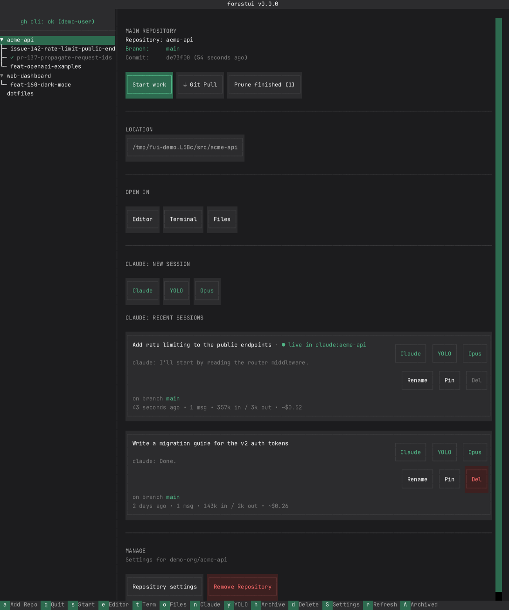
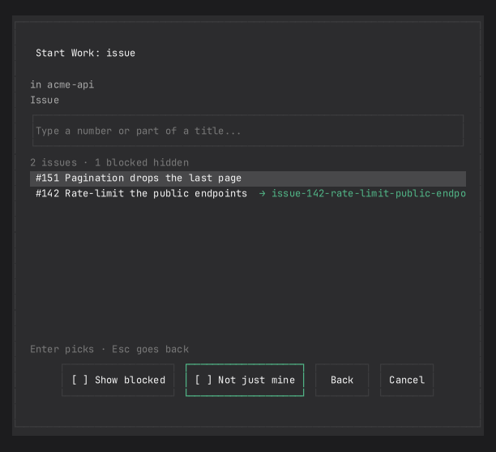

# forestui

> A terminal UI for managing Git worktrees, inspired by [forest](https://github.com/ricwo/forest) for macOS by [@ricwo](https://github.com/ricwo).

forestui brings Git worktree management to the terminal with a TUI built on
[ratatui](https://ratatui.rs), featuring deep integration with
[Claude Code](https://claude.ai/code).



## Features

- **Repository Management**: Add and track multiple Git repositories
- **Worktree Operations**: Create, rename, archive, and delete worktrees;
  worktrees made outside forestui (`git worktree add`) show up on their own
- **TUI Editor Integration**: Opens TUI editors (vim, nvim, helix, etc.) in tmux windows
- **Claude Code Integration**: Track and resume Claude Code sessions per
  worktree. Each one runs inside your shell, so Ctrl+Z, a crash or a refused
  launch leaves a prompt instead of a dead window
- **Session Management**: See which sessions are live, in a tmux window
  or elsewhere on the machine; rename, pin, and delete sessions, and read
  each conversation's branch, token totals, and estimated cost off its card
- **Start work**: Go from an issue, a pull request or a one-line idea to a
  worktree with Claude already running in it, primed with a prompt — or
  just make a plain worktree
- **Blocked issues**: Issues blocked by another open issue stay out of
  Start work's lists until you ask for them
- **Finished worktrees**: See which worktrees' issues or PRs are done, and
  prune them with their branches in one go
- **Multi-Forest Support**: Manage multiple forest directories via CLI argument
- **tmux Native**: Runs inside tmux for a cohesive terminal experience
- **Single Binary**: No runtime, no virtualenv — one static executable

## Requirements

- tmux
- [gh](https://cli.github.com/) (optional, for GitHub integration)
- Rust 1.88+ (only if you build from source)

## Installing

### Quick Install (recommended)

Downloads the prebuilt binary for your platform and verifies its published
checksum before installing.

```bash
curl -fsSL https://raw.githubusercontent.com/flipbit03/forestui/main/install.sh | sh
```

### Install with cargo

```bash
cargo install forestui --locked
```

Prebuilt binaries are published for:

| Platform | Target |
|---|---|
| Linux x86_64 | `x86_64-unknown-linux-musl` |
| Linux aarch64 | `aarch64-unknown-linux-musl` |
| macOS Apple silicon | `aarch64-apple-darwin` |

The Linux binaries are statically linked, so they carry no glibc floor and run
anywhere. Intel Macs and every other platform build from source with
`cargo install forestui`.

### Updating

forestui keeps itself up to date. It checks for a new release in the background
after the UI is up — never blocking startup — and once a newer version is in
place, the title bar says so until you restart:

```
forestui v2.0.0 (v2.0.1 ready — restart to update)
```

Quit and reopen forestui to pick it up; your tmux windows are untouched.

A binary installed from a release replaces itself. One installed with
`cargo install` reports the new version in the title instead of recompiling
underneath you, so you can update when it suits:

```bash
cargo install forestui --locked
```

Pass `--no-self-update` to skip the check entirely. A build from source
(version `0.0.0`) never updates itself at all.

## The Claude integration

One installable plugin gives forestui two abilities: shared names and
liveness. Each tmux tab and the Claude session inside it stay under one name —
a session opened from forestui is named after its tab from the moment it
opens, renaming the tab renames the session, and `/rename` inside Claude
renames the tab; the name is used verbatim, no prefix added or stripped, and
resuming keeps it. And every session on the machine reports where it is
running, so forestui sees sessions it did not start — a `claude -r` typed
into a hand-made window, or a terminal with no tmux at all.

Every session card shows what forestui knows about the conversation: the
branch it last saw, its token totals with an estimated cost, and — when the
session is running — a live badge: the window's name when it sits in a tmux
window forestui can jump to, "live in tmux session <name>" when it runs in a
window of another session on the same tmux server, or "live elsewhere" when
the plugin's heartbeat finds it running in some other terminal entirely.
Resuming a session that is already open offers to
switch to its window instead of starting a second Claude on the same
transcript — or, from another tmux session, to move that window into
forestui's session, Claude still running in it. Cards also carry `Rename` (a live session renames through its tmux
window, a stopped one through its transcript), `Pin` (pinned sessions stay at
the top of the list however old they get; reorder them with `K`/`J` while the
cursor is on a pinned card), and `Del` (permanent, confirmed, and refused
while a window holds the transcript open).

```bash
forestui --claude-plugin status      # what an install would write
forestui --claude-plugin install
forestui --claude-plugin uninstall
```

This installs a Claude Code plugin as its own directory. Your
`~/.claude/settings.json` is not modified and your existing hooks are
untouched. Only windows forestui opened are affected — a `claude` you start
yourself, in or out of tmux, is left alone.

### Remote Control

Every session forestui opens — `Claude`, `YOLO`, custom buttons, and resumes
from a session card — starts with `--remote-control`, so it can be picked up
from claude.ai or the Claude app without remembering to `/rc` first. The
remote session carries the same name as the session and its tmux tab, and
follows `/rename`. It is on by default, including for an existing install
after an update; untick Settings → *Start sessions with Remote Control*
to turn it off. Windows already open keep whatever they started with.

Claude Code has its own *Enable Remote Control for all sessions* in
`/config`; that one reaches every `claude` on the machine, this one only the
sessions forestui starts.

### Claude runs inside your shell

A tmux window forestui opens for Claude runs your shell, and Claude is a job
of that shell rather than the window's only process. So nothing is lost when
Claude stops:

- **Ctrl+Z** suspends Claude to a prompt; `fg` resumes it.
- **A crash or a refused launch** leaves a prompt with the command in your
  history, so the up arrow retries it.
- **A clean exit** — Ctrl+D twice, Ctrl+C twice or `/exit` — ends the
  session and closes its window. tmux then shows the window you were in
  before, which is not necessarily forestui.

Your shell starts the same way an interactive shell always does, with your
own startup files. zsh, bash and the POSIX shells (sh, dash, ksh, mksh,
ash, yash) get this directly. Other shells, such as fish, get the command
typed into them instead, and their window drops to a prompt when Claude
exits.

#### Going back to forestui without stopping Claude

Ctrl+D quits Claude; it never sends it to the background. To leave a session
working and go back to forestui, press the **back key**: your tmux prefix and
then `←` (`Ctrl+B ←` by default). Claude keeps running in its own window, and
the status line of a Claude window says so (`C-b ← forestui`). The back key
only acts in Claude windows forestui opened; everywhere else the key does
what it did before (tmux's default moves to the pane on the left).

If you have bound prefix + `←` yourself, forestui asks once: pick another key,
use it anyway (your binding keeps working outside Claude windows), or turn it
off. Change it later under **Settings → Back key to forestui**. forestui puts
your binding and `status-right` back when it exits.

Plain tmux window switching works too. forestui is the first window of its
tmux session, so press your tmux prefix and then `0` (`Ctrl+B 0` by default;
`1` if your tmux sets `base-index 1`). `Ctrl+B l` goes back to the window you came from,
`Ctrl+B w` picks one from a list, and `Ctrl+B d` detaches tmux altogether,
leaving forestui and every session running; start `forestui` again to
reattach.

To return to a running session from forestui, press **Claude** on its card,
which shows `● live in <window>`. forestui offers to switch to that window
instead of starting a second Claude on the same conversation.

## Usage

```bash
# Start with the default forest directory (~/forest)
forestui

# Start with a custom forest directory
forestui ~/my-projects

# Show help
forestui --help

# Stop asking the terminal to report pointer movement, or focus changes
# (see "If tmux's prefix key stops working")
forestui --no-hover
forestui --no-focus-events
```

### Keyboard Shortcuts

Focus moves between the sidebar and the detail pane with `Tab`. Inside either
pane, `↑`/`↓` move and `Enter` activates.

| Key | Action |
|-----|--------|
| `Tab` | Switch focus between sidebar and detail pane |
| `↑` / `↓` | Move within the focused pane |
| `PgUp` / `PgDn` | Page the sidebar, or scroll the detail pane |
| `Enter` | Select a row / activate the focused control |
| `a` | Add repository |
| `s` | Start work (an issue, a session, a PR review, or a plain worktree) |
| `e` | Open in editor |
| `t` | Open in terminal |
| `o` | Open in file manager |
| `n` | Start Claude session |
| `y` | Start Claude session (YOLO mode) |
| `h` | Toggle archive on the selected worktree |
| `A` | Show or hide the archived section |
| `d` | Delete |
| `S` | Settings |
| `r` | Refresh |
| `q` / `Ctrl+C` | Quit |
| `K` / `J` | Move a pinned session up or down (cursor on its card) |

In modals: `Tab` / `Shift+Tab` move between fields, `Enter` activates, `Esc`
cancels. Confirmation dialogs also accept `y` and `n`. The custom-buttons
manager uses `a` add, `e` edit, `d` delete, `K` / `J` reorder, `s` save.

### Mouse

The mouse works everywhere the keyboard does. Controls light up as the pointer
crosses them, so what is clickable is visible rather than guessed at:

- **Click** a repository or worktree in the sidebar, a control in the detail
  pane, a field to focus it, any modal button, or a key in the footer bar —
  clicking `S Settings` there is the same as pressing `S`.
- **The `▼` / `▶` twisty** beside a repository folds its worktrees away without
  changing what is selected.
- **The scroll wheel** scrolls whichever pane the pointer is over, whether or
  not it holds the keyboard focus.
- **The scrollbar** can be dragged, and clicking its track pages to that point.
- **Hovering a sidebar row** too long for the sidebar shows its full text in
  a box over the pane beside it.

### If tmux's prefix key stops working

tmux drops a pending prefix when the next thing it receives is a key it cannot
find in its `prefix` key table, and a mouse or focus report is such a key. So
`C-a` followed by one of those silently does nothing, and the key you typed
after it is lost.

forestui asks the terminal for two reports that can land in that gap. Either
can be turned off:

| Flag | You lose | The prefix stops being eaten by |
|------|----------|---------------------------------|
| `--no-hover` | controls no longer light up under the pointer; clicks, wheel and drag still work | pointer movement (`?1003h`), while forestui's pane is active |
| `--no-focus-events` | no refresh the moment you return to the window — `r` and the 30-second sweep still do it | focus changes, in every window on that tmux server |

`focus-events` is a tmux *server* option, and forestui turns it on. It hands it
back on exit, including after a run that was killed before it could — but if
your own tmux config turns it on, it stays on and the flag cannot help with
that half.

### Worktrees

git, not forestui's config, decides which worktrees exist. forestui compares
each repository against `git worktree list` on startup, when you select it,
when you come back to forestui and every 30 seconds, so a worktree made
or removed outside forestui — by hand or by an agent — shows up or goes away
on its own. The config only remembers what forestui adds: names, the
archived flag and the order.

Deleting a worktree with uncommitted changes asks a second time, showing
what would be lost (`3 modified, 1 untracked`), behind an explicit **Delete
anyway**.

### TUI Editor Integration

When your default editor is a TUI editor (vim, nvim, helix, nano, etc.),
forestui opens it in a new tmux window named `edit:<worktree>`. This keeps your
editing session organized alongside forestui and any Claude sessions.

Supported TUI editors: `vim`, `nvim`, `vi`, `emacs`, `nano`, `helix`, `hx`,
`micro`, `kakoune`, `kak`

### Multi-Forest Support

forestui stores its state (`.forestui-config.json`) in the forest directory
itself, so you can manage multiple independent forests:

```bash
forestui ~/work      # Uses ~/work/.forestui-config.json
forestui ~/personal  # Uses ~/personal/.forestui-config.json
```

User preferences (editor, theme, branch prefix, custom Claude buttons) are
stored globally in `~/.config/forestui/settings.json`.

### Start work

`s` (or **Start work** at the top of a repository's pane) starts a piece of
work in three steps:



1. **Pick a work mode**: `issue`, `session`, `pr-review` or `worktree`.
   `issue` lists every open issue. One carrying a feature label
   (`enhancement` by default) starts as a feature, with the `feature`
   naming (`feat-<n>-<slug>` on `feat/<n>-<slug>`) and the plan-first `feature.md` prompt;
   every other issue starts with the `issue` naming and `issue.md`. The
   confirm screen says which: `Feature #7` or `Issue #7`.
2. **Pick a work item** from a fuzzy-searchable list. By default it holds
   only your items: issues assigned to or opened by you, PRs with a review
   requested from you or opened by you. Tick **Not just mine** to list every
   open one for this pick. The `session` mode has no list: you type a
   **session prompt** instead, for a Claude session that is not about an
   issue or a PR. It stays local and never creates a GitHub issue.
   The confirm screen opens straight away with names made from the prompt's
   first words, while a headless Claude (`claude -p`, Haiku by default)
   reads the whole prompt in the background and suggests a better name. The
   suggestion replaces both names when it arrives, unless you have edited
   either one already; a failed or slow call just leaves the first-words
   names. You can launch at any time. Leave the prompt blank for a fresh
   worktree named for the minute it was started (`session-20261011-1432`),
   with Claude running in it and no first prompt, ready to talk to — or with
   your `session-blank.md`, if you wrote one (see Prompt templates). If the
   names on screen are taken when
   you launch, forestui asks whether to open the existing worktree, create a
   copy, or edit the name.
3. **Confirm** the worktree name, branch, base branch (with **Pull repo
   before creating**) and the filled-in prompt. **Edit prompt** opens the
   prompt in `$EDITOR` for this launch only, and **YOLO** skips permission
   prompts. **Launch** creates the worktree and starts Claude in it with the
   prompt as its first message.

Each worktree remembers the work item it was started for. Picking that item
again goes to the existing worktree, and to its running Claude window if it
has one, rather than creating a second one. A `pr-review` worktree checks out
the PR's own branch. Someone else's PR gets a review-and-report prompt; your
own gets a self-review that waits for your go-ahead before fixing anything.

The `worktree` mode skips the work item and the prompt: it asks for a
worktree name and a new or existing branch, creates the worktree, and starts
nothing in it. It needs no GitHub remote.

Selecting a repository fetches its open issues in the background, so the
`issue` list is usually filled by the time you open it. A
repository without a GitHub remote offers sessions and plain worktrees only.

#### Blocked issues

An issue that GitHub records as blocked by another *open* issue is hidden
from the `issue` list, and the count line above the list says
how many were left out (`2 blocked hidden`). Tick **Show blocked** to list
them, each marked with what blocks it (`blocked by #12`). The choice is
remembered across runs as `show_blocked_issues`.

#### Filtering issues

The **Filter** button under the `issue` list cycles through **All**,
**Features**, **Bugs** and **Other**. Features carry a feature label, bugs a
bug label, and Other lists the issues with neither, including unlabelled
ones. An issue with both labels is listed under Features and under Bugs, and
still starts as a feature. The filter applies before blocked issues are
hidden and before the search. It works with either scope. The count line
names it (`3 bug issues`). The choice is remembered across runs as
`issue_filter`.

#### Prompt templates

Each prompt comes from a Markdown template, with `{number}`, `{title}`,
`{branch}`, `{worktree}` and `{repo}` filled in. A session also gets
`{body}`, the prompt you typed, and its template, `session.md`, is `{body}`
alone, so by default Claude gets exactly what you typed. Issue and PR prompts
tell Claude to read the item with `gh` instead, so it sees the current text
and comments. A blank session prompt skips `session.md` and sends
`session-blank.md` instead, which ships empty: Claude starts with no first
message until you write one, such as `You are in {worktree} on {branch}.`
The templates are `issue.md`, `feature.md`, `session.md`, `session-blank.md`,
`session-name.md`, `pr-review-others.md` and `pr-review-own.md`.
`session-name.md` is not a first prompt: it is the instruction the name
suggestion sends, with the session prompt as `{body}`. Each one that has no file yet
uses the built-in default. Settings → **Edit Prompt Templates...** lists them;
picking one opens it in your editor under `~/.config/forestui/prompts/`,
writing the default first.

#### Repository settings

A repository's **Repository settings** control overrides the Start work
settings and templates for that repository alone, in
`~/.config/forestui/repos/<owner>/<name>/` (a `settings.json` read only for
its `start_work` section, plus a `prompts/` directory). Nothing is written
inside a checkout. The key is the `owner/name` that `gh` resolves for the
clone (see `gh repo set-default`). Each template is created from the global
version on first use.

Its **Start work settings** row opens the Start Work Settings dialog for
that repository. Every field there either inherits the global value, shown
dimmed in an empty field, or overrides it: type to override, clear the field
to inherit again, and cycle a toggle through **Inherit** and its values.
Saving writes only the overridden keys and keeps everything else in the
file; a file that does not parse is never written over. **Edit
settings.json...** opens the file itself, written from the global settings
if it does not exist yet. An explicitly empty override, such as
`"feature_labels": []`, can only be written in the file.

### Pruning finished worktrees

A worktree whose issue is closed, whose pull request is merged or closed, or
whose session branch is merged into the default branch is *finished*. The
repository pane's **Prune finished (N)** removes those worktrees together with
their local branches. The same prune runs from a shell, over every repository
in a forest, without tmux:

```bash
forestui prune          # ~/forest
forestui prune ~/work
```

Worktrees with uncommitted changes or commits on no remote branch are skipped
and listed. The exit status is non-zero only when a worktree could not be
pruned, not when one was skipped.

### Themes

Settings → Theme opens a picker over 32 named palettes — Dracula, Nord,
Gruvbox, Solarized, the Catppuccin and Rosé Pine and Tokyo Night families,
GitHub, SynthWave '84, and more — with the app behind the dialog live-previewing the
highlighted theme. Enter applies, Esc reverts, Save persists. The default,
Forest Dark, is the palette forestui has always had. The chosen theme is
stored in `theme_name`.

## Configuration

Settings are stored in `~/.config/forestui/settings.json`:

```json
{
  "default_editor": "nvim",
  "branch_prefix": "feat/",
  "theme_name": "forest-dark",
  "custom_buttons": [
    {
      "label": "Opus",
      "prefix": "opus",
      "command": "claude --model opus"
    }
  ],
  "remote_control": true,
  "show_blocked_issues": false,
  "issue_filter": "all",
  "start_work": {
    "scope": "mine",
    "feature_labels": ["enhancement"],
    "bug_labels": ["bug"],
    "issue": {
      "branch_prefix": "fix/",
      "name_pattern": "issue-{number}-{slug}",
      "branch_pattern": "issue-{number}-{slug}"
    },
    "feature": {
      "branch_prefix": "feat/",
      "name_pattern": "feat-{number}-{slug}",
      "branch_pattern": "{number}-{slug}"
    },
    "session": {
      "branch_prefix": "session/",
      "name_pattern": "session-{slug}",
      "branch_pattern": "{slug}"
    },
    "pr_review": { "name_pattern": "pr-{number}-{slug}" },
    "session_naming": {
      "enabled": true,
      "model": "haiku",
      "timeout_secs": 20,
      "allowed_tools": []
    }
  }
}
```

Press `S` in the app to open the settings modal.

`start_work` configures Start work (`s`). Settings → **Start Work
Settings...** edits every key below except `bug_labels`, so the file rarely
needs touching:

- `scope` — `mine` lists issues assigned to or opened by you and PRs with a
  review requested from you or opened by you; `all` lists every open one.
  The picker's **Not just mine** checkbox switches it for a single pick.
- `feature_labels` — an issue carrying any of these (case-insensitive)
  starts as a feature, with the `feature` naming and `feature.md`; every
  other issue starts with the `issue` naming and `issue.md`. Both are
  listed together under `issue`.
- `bug_labels` — an issue carrying any of these (case-insensitive) is a
  bug for the issue filter. It does not change how the issue starts.
- Per kind of work (`issue`, `feature`, `session`, `pr_review`), the
  worktree is named by `name_pattern` with `{number}` and `{slug}` (from the
  title, or a session prompt's first six words) filled in, and the branch is
  `branch_prefix` followed by `branch_pattern`, filled the same way. The
  worktree name carries the kind for the sidebar; the branch leaves it to the
  prefix, so a feature is `feat-7-dark-mode` on `feat/7-dark-mode` rather
  than `feat/feat-7-…`. Setting only `name_pattern` leaves the branch on the
  default `branch_pattern`, and a `branch_pattern` that fills to nothing
  falls back to the worktree name. A `pr-review` worktree checks out the
  PR's own branch, so it has neither a prefix nor a `branch_pattern`.
- `session_naming` — the name suggestion for sessions (see below):
  `enabled`, the `model` it runs (an alias such as `haiku` or a full model
  name), `timeout_secs` before the first-words names are kept, and
  `allowed_tools`, the Claude Code tools it may use (none by default, so it
  reads only your prompt).

Every key is optional; a missing one keeps the default shown above.

Custom Claude buttons add extra entries to the CLAUDE section of the detail
pane. Each one opens a tmux window named `<prefix>:<worktree>` running its
command verbatim. A command containing `--dangerously-skip-permissions` is
styled red.

## Development

```bash
# Clone and enter the repo
git clone https://github.com/flipbit03/forestui.git
cd forestui

# Install the toolchain components
make dev

# Run checks (format, clippy, typecheck, tests)
make check

# Format code
make format

# Run the app
make run
```

See [CLAUDE.md](CLAUDE.md) for AI-assisted development guidelines, and
[doc/rust-rewrite/](doc/rust-rewrite/) for the specification, architecture,
migration plan, and the `tu`-driven acceptance playbook.

## Compatibility with forest (macOS)

forestui is designed to coexist with [forest](https://github.com/ricwo/forest)
for macOS:

- Both apps can share the same `~/forest` directory for worktrees
- Each app maintains its own state file:
  - forest: `.forest-config.json` (stored in `~/.config/forest/`)
  - forestui: `.forestui-config.json` (stored in the forest folder itself)
- Worktrees created by either app work seamlessly with both

**Key difference:** forestui stores its state inside the forest folder
(`~/forest/.forestui-config.json`) rather than in a global config directory.
This design enables multi-forest support — you can run `forestui ~/work` and
`forestui ~/personal` with completely independent state for each.

## License

MIT
